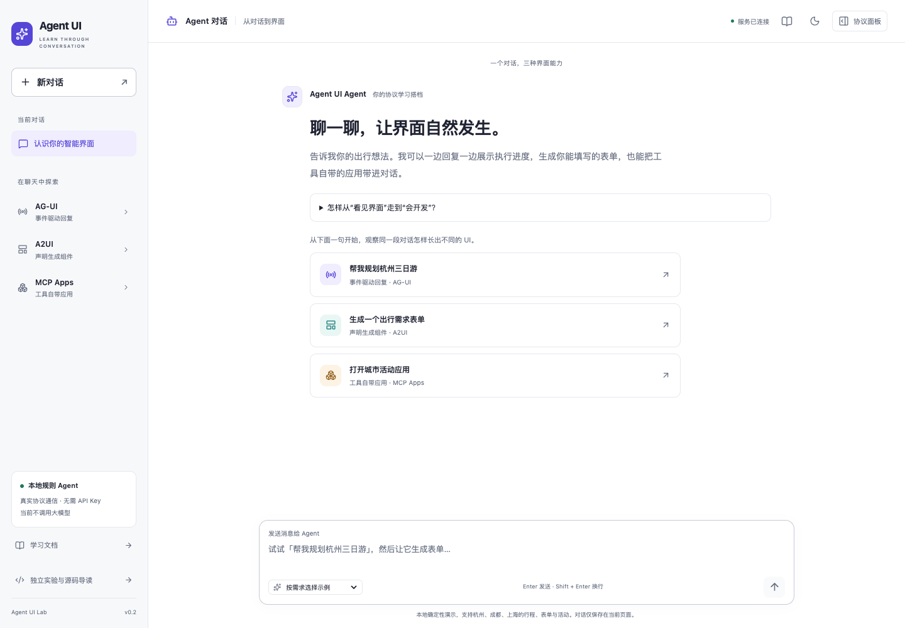
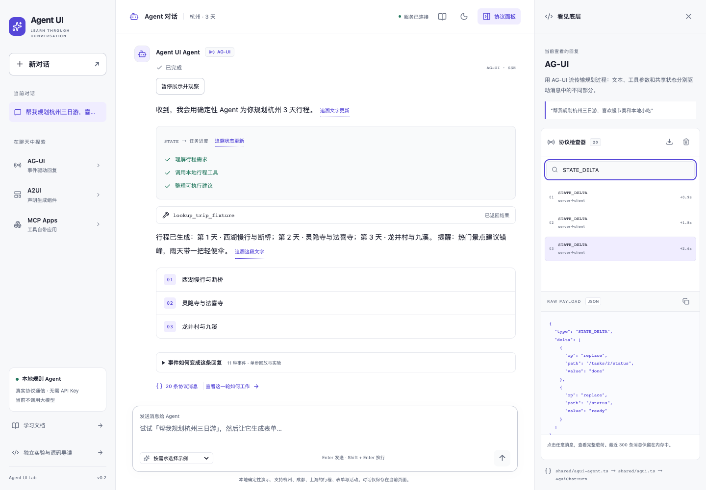
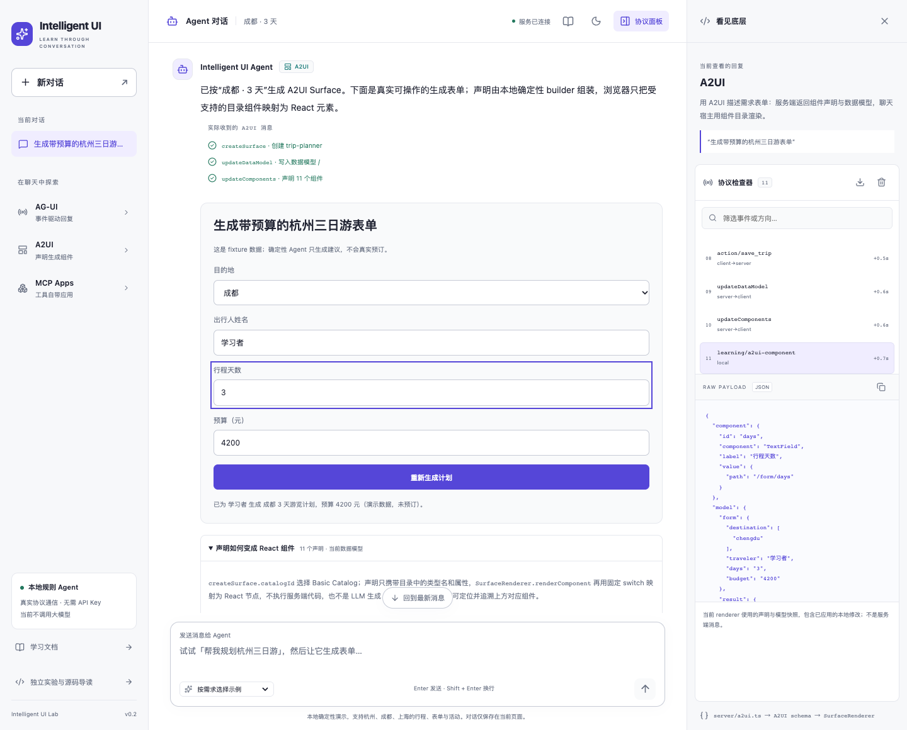
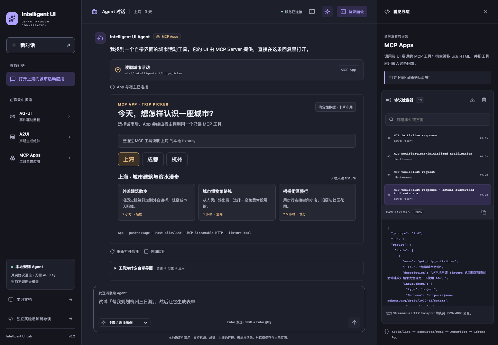
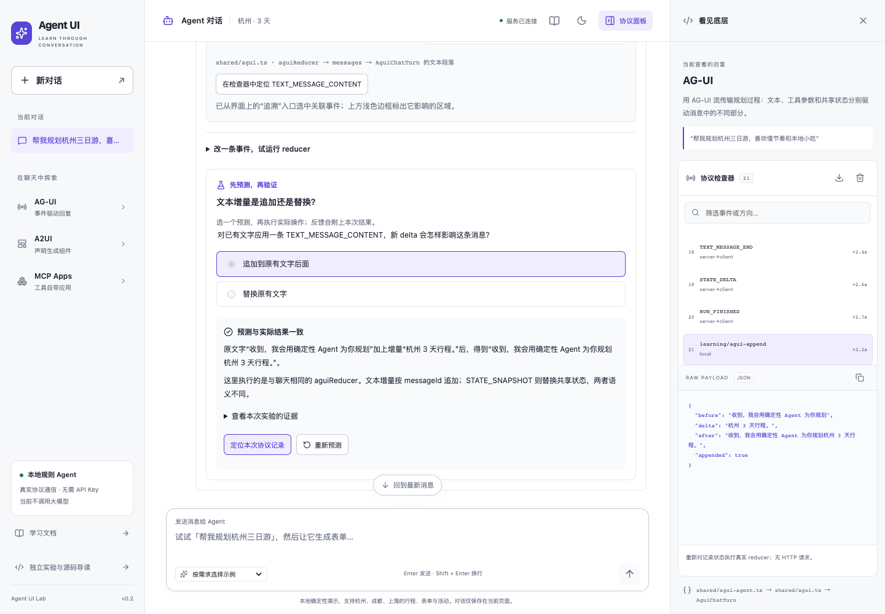
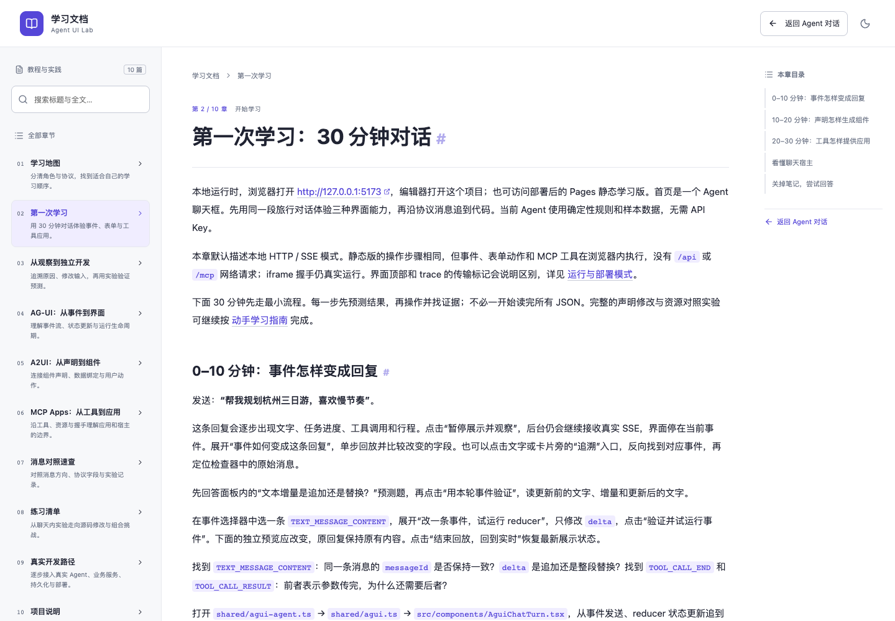
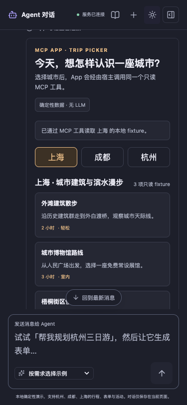

# Agent UI Lab

<a href="https://github.com/likebeans/agent-ui-lab/actions/workflows/deploy-pages.yml"></a>

**在浏览器里操作 Agent UI，把界面变化对应到协议消息、状态和源码。**

Agent UI Lab 是面向前端开发者的交互式学习项目与参考实现。通过一段旅行对话，你可以观察 AG-UI 的执行事件、填写 A2UI 生成的表单，再打开 MCP Apps 工具应用。每种界面都有协议检查器和动手实验，方便你查清一次更新的原因，并修改输入验证理解。

**无需模型密钥。** 项目使用确定性规则与样本数据，不调用大语言模型（LLM）。在线版可直接操作；本地版还可观察 HTTP、服务器发送事件（SSE）和 MCP 服务通信。

当前稳定版本为 [v0.1.0](https://github.com/likebeans/agent-ui-lab/releases/tag/v0.1.0)，采用 [MIT 许可证](#许可证)。

[在线体验](https://likebeans.github.io/agent-ui-lab/) · [快速开始](#快速开始) · [协议对比](#三个协议分别做什么) · [界面演示](#在一段对话中体验三种能力) · [学习路径](#怎样用这个项目学习) · [部署说明](#部署与-github-pages) · [反馈与贡献](#反馈与贡献)



## 快速开始

先打开[在线静态学习版](https://likebeans.github.io/agent-ui-lab/)，按下方三句提示词体验。需要查看网络请求、修改源码或验证 SQLite 持久状态时，在本地运行。

本地需要 **Node.js 22.13+**、npm 和浏览器，推荐 Node 24（`.nvmrc`）。任务恢复、人工确认与活动报名联合实验使用 Node 内置 SQLite，无需安装数据库服务。最低版本检查与贡献流程见[维护指南](docs/10-maintaining.md)。

```bash
git clone --branch v0.1.0 https://github.com/likebeans/agent-ui-lab.git
cd agent-ui-lab
npm ci
npm run dev
```

上面的命令检出已发布版本。跟随最新维护进度可切换到 `main`；准备修改源码时，从当前版本创建自己的分支。

打开 <http://127.0.0.1:5173>。同一命令启动 Vite 前端和 Express API / MCP 后端，所有基础与进阶实验都在这一个应用中，通过导航切换。

后端默认使用 <http://127.0.0.1:3100>，前端代理 `/api` 与 `/mcp`。两个端口都需空闲；启动器遇到冲突会停止，不会自动换端口。自定义配置见[实验基础与并行开发](docs/labs/foundation.md#worktree-配置隔离)。

## 三个协议分别做什么

Agent UI 关注 Agent 执行任务时的界面交互。下面三个协议分别处理事件、组件声明和工具应用，可以按业务需要选用。

| 协议         | 处理的内容                                 | 在这里观察什么                              |
| ------------ | ------------------------------------------ | ------------------------------------------- |
| **AG-UI**    | 执行生命周期、文本增量、工具调用与共享状态 | 事件如何经 reducer 更新文字、步骤和任务卡片 |
| **A2UI**     | 组件声明、数据绑定与用户动作               | 一份声明如何生成表单，输入怎样解析为 action |
| **MCP Apps** | 工具关联的 UI 资源与 App / Host 通信       | 工具应用怎样加载、握手，再通过宿主调用工具  |

MCP 指 Model Context Protocol，Host 是承载应用并代理能力请求的宿主。本项目每轮回复使用一种协议，城市和天数会在轮次间共享；预算、人数与偏好不会自动完整继承。当前没有把 A2UI 或 MCP Apps 消息封装进 AG-UI。A2UI 与面向 Agent 间通信的 A2A 是不同的协议。

## 在一段对话中体验三种能力

在聊天中按顺序发送下面三句话，观察同一份旅行需求怎样对应不同界面。示例支持杭州、成都和上海。

### 1. AG-UI：观察执行过程

发送 **“帮我规划杭州三日游，喜欢慢节奏和本地小吃”**。

回复中的文字、步骤状态和工具结果随事件更新。打开协议面板，可以查看 `TEXT_MESSAGE_CONTENT`、`TOOL_CALL_ARGS`、`STATE_DELTA` 等原始载荷。



点击“追溯文字更新”，比较同一事件到达前后的状态。暂停展示后可单步回放；后台接收与界面回放分别控制，取消运行也有独立的确认过程。

阅读[AG-UI 教程](docs/01-ag-ui.md)，继续验证取消、断流和错误路径。

### 2. A2UI：填写声明生成的表单

继续发送 **“把这些出行需求做成一个表单”**。

前端将 `createSurface`、`updateDataModel`、`updateComponents` 中的声明映射为 React 控件。填写姓名、修改天数，再点击“生成计划”，对照 `action.context` 与返回的更新。



展开“声明如何变成 React 组件”，从组件 ID 定位实际控件。Workshop 支持编辑组件与数据模型，还可以新增预算字段、验证绑定并完成提交。

阅读[A2UI 教程](docs/02-a2ui.md)，了解组件目录、数据绑定与动作校验。

### 3. MCP Apps：操作工具自带的应用

继续发送 **“打开这个城市的活动应用”**。

宿主发现工具关联的 `ui://` 资源，读取 HTML 并在沙箱 iframe 中加载应用。App 完成握手后展示工具结果；切换城市时，通过 Host 发起 MCP 工具调用。



展开“动手验证 MCP Apps 因果链”，分别尝试更新工具数据、切换布局资源。比较 `tools/call`、`resources/read` 与 iframe 挂载计数，确认哪些操作复用了原 App。

阅读[MCP Apps 教程](docs/03-mcp-apps.md)，理解工具、资源和宿主各自的职责。

此前消息中的表单和 App 可以继续操作。成功操作会更新共享的城市与天数，供后续轮次使用；预算、人数和偏好仍以各轮表单与输入为准。

聊天支持 1–7 天的整数，可使用“2天”“两日游”等写法。“12天”“十一日”“8天”、小数或多个不同天数会提示修改，不会截取其中一位或静默改用默认值。发送失败时可在原消息下选择“修改这条消息”或“重试这条消息”；等待期间输入的新草稿或主动清空会保留。

## 怎样用这个项目学习

适合已掌握 JavaScript / TypeScript 和基础 React，准备开发 Agent 前端、生成式 UI 或 MCP 工具界面的开发者。旅行是贯穿示例，学习重点是消息怎样驱动界面，以及失败后怎样恢复。

先按[第一次学习：30 分钟对话](docs/00-first-session.md)跑通场景，再按[从观察到独立开发](docs/07-learning-method.md)完成下面的学习循环：

| 学习动作       | 你来操作                               | 用什么验证                               |
| -------------- | -------------------------------------- | ---------------------------------------- |
| **追溯原因**   | 从文字、工具卡片或表单控件定位消息     | 原始载荷、更新前后状态、绑定路径与源函数 |
| **修改输入**   | 编辑事件、组件声明、工具参数或布局资源 | 同一 reducer、Renderer 或 App 的实际结果 |
| **预测并验证** | 先选择预期，再运行实验                 | 执行结果与协议证据；运行失败时不判分     |



### 进阶：处理恢复、确认与编辑冲突

项目提供八个独立实验：三种协议基础、实验接入示例，以及下面四个进阶实验。它们均可在线操作；本地模式还可验证 HTTP / SSE、SQLite 持久化和多页面共享状态。

| 实验                                                                                     | 动手验证                                                        | 教程                                          |
| ---------------------------------------------------------------------------------------- | --------------------------------------------------------------- | --------------------------------------------- |
| [任务恢复与事件重放](https://likebeans.github.io/agent-ui-lab/#labs/task-recovery)       | 断开接流后恢复同一 run，对照 checkpoint、事件游标与工具执行计数 | [任务恢复](docs/labs/task-recovery.md)        |
| [人工确认与业务事实](https://likebeans.github.io/agent-ui-lab/#labs/human-approval)      | 确认具体版本，丢失响应后先查询事实，再按需要重试原命令          | [人工确认](docs/labs/human-approval.md)       |
| [A2UI 兼容与编辑冲突](https://likebeans.github.io/agent-ui-lab/#labs/a2ui-compatibility) | 验证能力降级、字段错误、草稿冲突、过期动作与提交后丢失响应      | [兼容与冲突](docs/labs/a2ui-compatibility.md) |
| [活动报名联合实验](https://likebeans.github.io/agent-ui-lab/#labs/enrollment-workflow)   | 在同一任务中保存表单、核对版本、确认或拒绝，恢复事件与报名事实  | [联合实验](docs/labs/enrollment-workflow.md)  |

A2UI 兼容实验可勾选“下一次提交成功后丢失响应”，观察“界面没有收到回执”和“服务端没有执行”的区别。结果未知时先读取远端，保留当前草稿，再显式解决冲突；不会自动再次提交。

人工确认与联合报名实验支持“复制定位信息”和“打开已有任务”。打开只查询事实，不会重新生成提议、确认或重发命令；有未保存草稿时先确认是否放弃。定位信息用于查找任务，不承载业务事实；Pages 不能用它恢复刷新后已经清空的内存，本地可在同一服务实例的新标签页恢复 SQLite 中的任务。

完成后，用[独立项目任务书](docs/08-independent-project.md)换一个只读业务场景，实现并验证自己的闭环。学习任务已有[内部预演记录](docs/labs/learning-rehearsal.md)；[首次学习验收](docs/09-learning-validation.md)提供招募、任务卡与观察模板，尚未实际招募或观察首次读者。

### 在界面里阅读教程

聊天顶部的书本图标、独立实验导航和回复下方的教程链接，都能打开阅读器。手机聊天页的导航菜单还可进入“独立实验与源码导读”“实践路线”和“学习文档”，支持键盘操作与 Escape 关闭。

全文搜索会标出命中小节，点击结果后定位内容并短暂高亮关键词。标题链接可以复制，浏览器前进与后退也可切换阅读位置。



阅读文档后返回，当前消息、表单草稿、App 和协议记录会保留。聊天与上次独立实验之间也可往返。模块加载失败时有局部重试入口，避免一次加载失败中断其他工作区。

桌面与手机布局均支持深浅主题。下面的截图来自本地实际操作，本文其他截图也使用同一项目界面。



继续阅读：[学习地图](docs/README.md) · [消息对照速查](docs/06-protocol-reference.md) · [源码练习清单](docs/05-exercises.md) · [真实开发路径](docs/04-real-development.md)。

## 本地与 Pages 的区别

两种模式共用确定性引擎、协议校验与前端组件。在线体验标为“静态学习版”，实际传输方式也会出现在检查器与导出的 trace 中。

| 能力                         | 本地模式                                    | Pages 静态学习版                                                    |
| ---------------------------- | ------------------------------------------- | ------------------------------------------------------------------- |
| AG-UI                        | Express 通过 HTTP / SSE 发送事件            | 浏览器内生成事件，使用 `ReadableStream` 演示 SSE 编码；没有网络 SSE |
| A2UI                         | HTTP 请求声明、提交动作，由后端校验         | 在浏览器内执行声明生成与动作校验                                    |
| MCP Client / Server          | 官方 Streamable HTTP 传输                   | 官方 `InMemoryTransport` 传递 JSON-RPC                              |
| MCP App / Host               | 官方 AppBridge、沙箱 iframe、`postMessage`  | 相同的 App / Host 通信；HTML 资源由静态站点提供                     |
| 任务恢复、人工确认与联合报名 | 任务、事件、命令收据与业务事实保存到 SQLite | 数据仅在当前页面内存中，刷新后清空                                  |
| A2UI 冲突实验                | 服务进程共享文档，可用两个页面比较版本      | 每个页面使用独立的内存文档                                          |

Pages 中的 `POST /api/...` trace 是教学逻辑路由标签，**不代表向该地址发送了 HTTP 请求**。浏览器内调用标为 `browser-memory`，App / Host 消息标为 `postMessage`。

聊天状态在刷新或新建对话时重置。切换不同独立实验会重新创建实验界面；任务身份、表单草稿和已提交事实有不同的生命周期。人工确认与联合报名的 Pages 任务可在同一页面内通过定位信息再次打开；刷新或新标签页拥有新的内存，不会自动重放旧命令。本地任务与业务事实可按实验教程查询恢复，SQLite 文件位于 `LAB_DATA_DIR/lab.sqlite`；主题偏好保存在浏览器本地。

## 代码与协议基线

前端使用 React 19、TypeScript 与 Vite，后端使用 Express 和 Node 内置 SQLite，测试使用 Vitest 与 Playwright。可以从下面的入口对照阅读：

| 想理解的实现         | 源码入口                                                            |
| -------------------- | ------------------------------------------------------------------- |
| 对话路由与共享上下文 | `shared/chat-agent.ts`、`src/ChatWorkspace.tsx`                     |
| AG-UI 事件与回复渲染 | `shared/agui-agent.ts`、`src/components/AguiChatTurn.tsx`           |
| A2UI 声明与组件映射  | `shared/a2ui-agent.ts`、`src/components/A2uiSurfaceRenderer.tsx`    |
| MCP 工具与 UI 资源   | `shared/mcp-server.ts`、`server/mcp.ts`、`server/mcp-resource.ts`   |
| 实验注册与进阶逻辑   | `src/labs/registry.ts`、`src/labs/`、`shared/labs/`、`server/labs/` |
| SQLite 与文档阅读    | `server/storage/sqlite.ts`、`src/DocsReader.tsx`                    |

本项目固定了协议与 SDK 基线，具体依赖以 `package-lock.json` 为准：

| 部分     | 当前基线                                  | 实现范围                                                                                 |
| -------- | ----------------------------------------- | ---------------------------------------------------------------------------------------- |
| AG-UI    | 协议 1.0，`@ag-ui/core` 1.0.3             | 官方事件 schema 与教学 reducer；状态补丁仅支持安全的 `replace`                           |
| A2UI     | v0.9.1                                    | `Card`、`Column`、`Text`、`TextField`、`ChoicePicker`、`Button` 六种组件及绑定、动作校验 |
| MCP Apps | ext-apps 2.0.3，MCP client / server 2.3.1 | 官方 SDK、两个 UI 资源、一个只读工具和受控宿主                                           |

## 开发与验证

修改代码后，按需要执行检查。浏览器套件会自行启动对应服务：

```bash
npm run check         # 单元与集成测试、类型检查、普通构建
npm run test:e2e      # 本地 HTTP / SSE 与界面交互
npm run test:pages    # 子路径下的静态版，无 API / MCP 网络请求
npm run format:check # 格式检查
```

浏览器测试默认使用本机 Google Chrome。没有 Chrome 时，先运行 `npx playwright install chrome`；CI 使用 Playwright Chromium。

预览带后端的构建产物：

```bash
npm run build
npm start
```

随后访问默认后端地址 <http://127.0.0.1:3100>。`npm start` 仅监听本机，用于本地预览。自定义端口、实例身份和数据目录的配置见[实验基础教程](docs/labs/foundation.md)。

新增实验在 `src/labs/<id>/manifest.ts` 声明入口，教程放入 `docs/labs/<id>.md` 后会自动进入阅读器和搜索。更新本文截图时，保持 `npm run dev` 运行，再执行 `npm run screenshots:readme`。

## 部署与 GitHub Pages

静态版使用独立构建模式，无需启动 API 服务。在自己的仓库发布时：

1. 在 **Settings → Pages → Build and deployment → Source** 中选择 **GitHub Actions**。
2. 推送到 `main`，或手动运行 **Actions → Deploy GitHub Pages**。
3. 等待完整 CI、发布路径下的构建与浏览器检查通过，再查看 `github-pages` 环境中的访问地址。

[发布工作流](https://github.com/likebeans/agent-ui-lab/actions/workflows/deploy-pages.yml)从 Pages 配置读取资源路径，支持仓库子路径、根站点与已配置的自定义域名。校验和发布使用同一提交；部署前会再次确认它仍是 `main` 的最新提交。失败、取消或过时的发布不会覆盖站点。

在本地预览静态版：

```bash
npm run build:pages
npm run preview:pages
```

打开 <http://127.0.0.1:4173>。模拟仓库子路径时，在上述两个命令前都设置 `PAGES_BASE_PATH=/agent-ui-lab/`，再访问对应子路径。聊天、实验和文档均使用 hash 路由，刷新深链接不需要服务器回退规则。

普通构建与 Pages 构建都写入 `dist/`，请顺序执行，切换模式时重新构建。发布静态站点使用 `build:pages`。

## 项目范围与扩展方向

`v0.1.0` 是已发布的教学版本，覆盖从界面操作、协议证据追溯到独立开发练习的学习路径。后续维护以修复可复现缺陷、改善教程与保持依赖兼容为主。

旅行和报名数据均为教学样本，不产生真实预订、支付或外部业务写入。聊天按规则或手动选择决定协议，尚未实现模型自主规划、长期记忆或任意工具组合。

A2UI 使用上表列出的组件子集。MCP Host 只加载项目自带资源；接入第三方应用或真实业务时，需要补齐鉴权、会话隔离、宿主策略与持久化设计，参见[真实业务接入](docs/04-real-development.md)。

可探索的扩展包括远程 API / MCP 服务配置、真实 Agent 接入、持久聊天会话和真实业务数据源。这些尚未实现，未承诺交付时间，也不是运行当前教学版本的前提。

## 反馈与贡献

欢迎通过 [Issue](https://github.com/likebeans/agent-ui-lab/issues)反馈启动问题、可复现缺陷和难以理解的教程步骤。请说明使用的版本或提交、本地或 Pages 模式、浏览器及 Node 版本（如适用）、复现步骤、预期与实际结果；附截图或协议记录时请先移除个人信息与密钥。

准备提交改动时，先阅读[维护与贡献验证](docs/10-maintaining.md)，在自己的分支修改并运行相关检查。教学示例请附预期行为和实际验证证据；真实读者观察与自动化检查、内部预演分开记录。

## 许可证

本项目采用 [MIT 许可证](https://github.com/likebeans/agent-ui-lab/blob/main/LICENSE)。使用、修改或分发时，请保留许可证中的版权声明和许可声明。第三方依赖遵循各自的许可证。

## 官方资料

- [AG-UI 协议文档](https://docs.ag-ui.com) · [AG-UI 源码](https://github.com/ag-ui-protocol/ag-ui)
- [A2UI 协议文档](https://a2ui.org) · [A2UI 源码](https://github.com/a2ui-project/a2ui)
- [MCP Apps 扩展文档](https://modelcontextprotocol.io/docs/extensions/apps) · [MCP Apps SDK 与示例](https://github.com/modelcontextprotocol/ext-apps)
